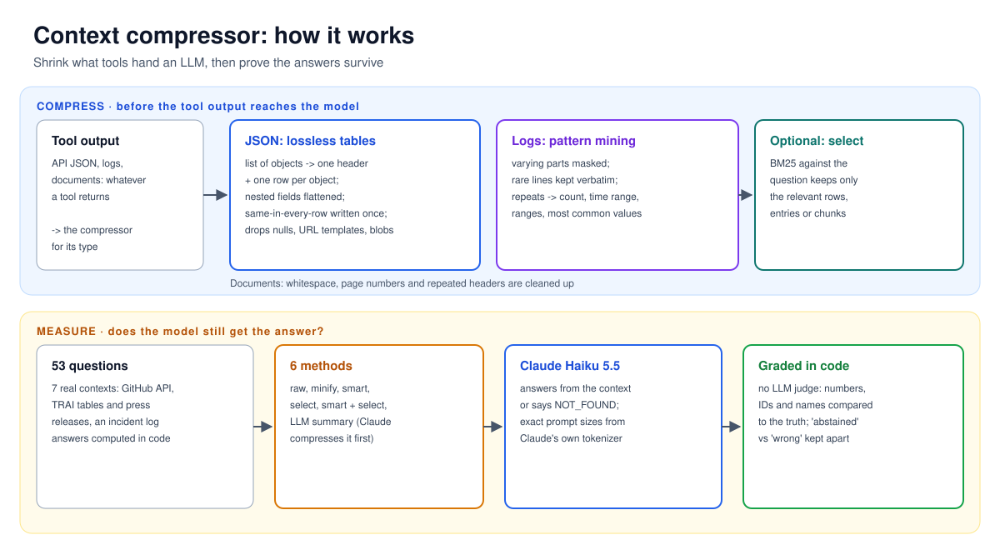
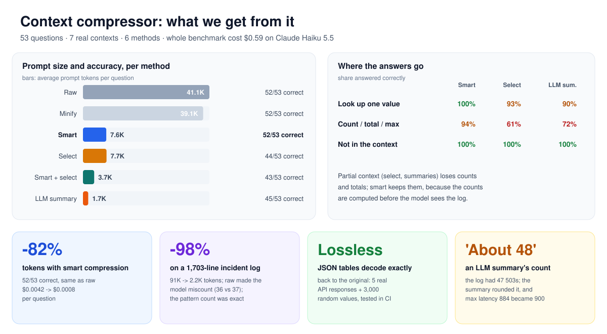
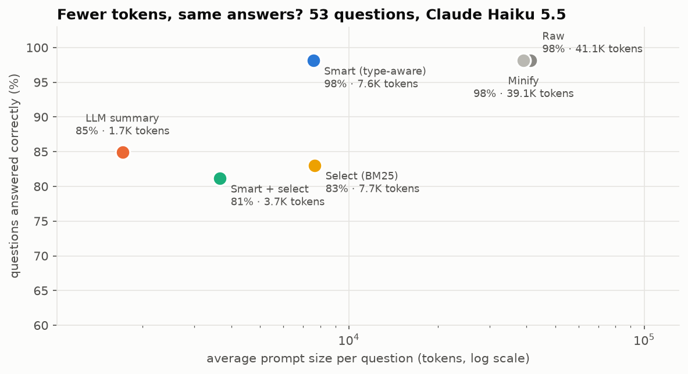
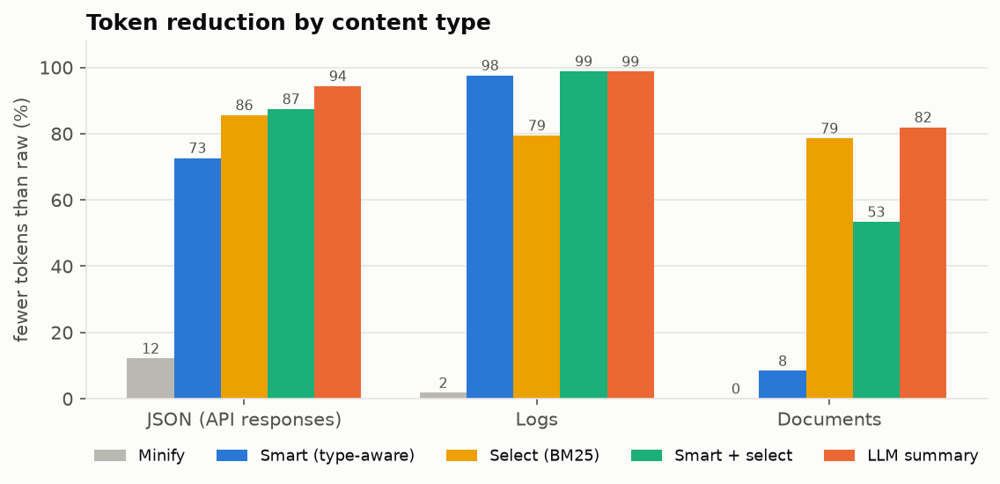
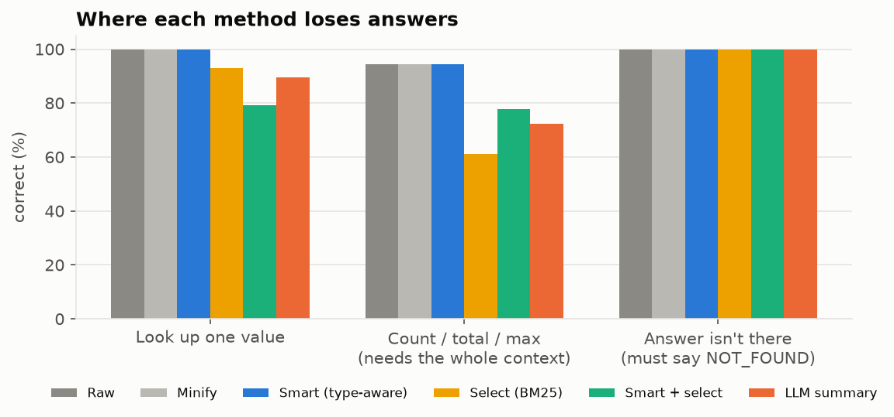

# 🗜️ Context Compressor: fewer tokens, same answers

**Tools hand LLM agents huge outputs: API JSON full of URLs and repeated fields, logs with thousands of near-identical lines, long documents. `ctxcompress` shrinks them before they reach the model, and a 53-question benchmark on real data measures what that costs in accuracy.**

Headline (Claude Haiku 5.5): **82% fewer prompt tokens, 52/53 correct, the same as the uncompressed prompts.** On a 1,700-line incident log the prompt goes from 91K to 2.2K tokens. Token-cutting tools are trending, but most report savings without checking the answers. This project measures both.


---

## How it works



## What we get from it



## Three compressors, one call

```python
from ctxcompress import compress

small = compress(tool_output)                                   # detects JSON / log / text
tiny = compress(tool_output, "smart+select", query=question)    # plus query-aware selection
```

### JSON: lossless tables

A list of objects becomes a table: the field names once, then one row per object. Nested objects are flattened into dotted columns. A field with the same value in every row is written once, in an `=same` line. Simple strings lose their quotes.

The encoding is **lossless**: `jsonc.decode` returns exactly the original value. The tests check this on 5 real API responses and 3,000 random values, including strings that look like numbers, commas, newlines, dotted keys and empty objects.

The only lossy step is optional pruning, which drops nulls and empty values, URL templates (`.../issues{/number}`) and opaque blobs such as PGP signatures.

```text
records[86]{circle,operator,subscribers,active_pct}:
  =same {"month":"2025-11","unit":"subscribers","source":"TRAI Telecom Subscription Data, Annexure II/III","revised":false}
  Andhra Pradesh,Airtel,34475970,97.13
  Andhra Pradesh,BSNL,7440211,64.14
  ...
```

The same 86 records as pretty-printed JSON take 10,200 tokens. In this format they take 2,050.

### Logs: pattern mining

Numbers, hex IDs, UUIDs and IPs are masked to turn each entry into a pattern. A slot with only a few values, such as an HTTP status or a version, stays literal, so `200` and `503` remain separate patterns.

- **Rare patterns stay verbatim:** one-off errors, deploys and rollbacks survive word for word.
- **Repeated patterns become one line:** a count, the time range, a range and average for measurements, and the most common values for IDs.
- **Stack traces stay attached** to their log line.

```text
[x469 2026-10-12T09:00:05.751Z→10:59:54.831Z] INFO  [checkout-api] GET /api/v1/cart/<1> 200 <2>ms user=<3> req=<4>
    <1>: 467 distinct, e.g. 57694, 10336 | <2>: 10-477, avg 243 | <3>: 268 distinct; most common u4821 x37, u9935 x5, u4201 x5 | ...
2026-10-12T10:02:11.000Z INFO  [deployer] deployed payment-svc version 2.14.1 (commit 9f3c2ab) by ci-bot
[x47 2026-10-12T10:03:03.183Z→10:31:04.481Z] ERROR [payment-svc] POST /api/v1/pay 503 upstream timeout after 5000ms ...
```

### Documents and query-aware selection

Documents get light cleanup: whitespace, page numbers and repeated running headers.

`select` is retrieval in the RAG style. It uses BM25 against the question to keep only the most relevant records, log entries or text chunks within a budget. It goes much smaller, but it is lossy in a way that depends on the question, and the benchmark shows exactly where that hurts.

## The benchmark

**53 questions over 7 contexts.** Every answer is computed in code from the source data, never typed by hand.

| Context | What it is | Raw tokens |
|---|---|---|
| `github_repos.json`, `github_runs.json`, `github_commits.json` | real GitHub REST API responses, as returned | 26K-40K |
| `telecom_nov2025.json`, `telecom_series.json` | TRAI subscriber data (from [telecom-india](https://github.com/abpandey-dev/telecom-india)) as an API-style response | 10K-14K |
| `trai_jul_aug_2026.txt` | text of TRAI's July and August 2026 press releases | 17K |
| `app.log` | a seeded 1,703-line service log: a bad deploy, 503s, a rollback, one-off errors | 91K |

The questions come in three kinds:

- **Lookups:** one value, such as a SHA, a timestamp or a subscriber count.
- **Aggregates:** counts, maximums and totals that need the whole context.
- **Absent:** the answer isn't there, so the right reply is NOT_FOUND.

**How it's graded:**

- **The model** is Claude Haiku 5.5, which answers from the context in a structured JSON reply.
- **Grading is done in code,** with no LLM judge: numbers within 0.1%, IDs and names by exact match. A NOT_FOUND on an answerable question counts as "abstained", separate from "wrong".
- **Prompt sizes** are exact counts from Claude's own tokenizer.



| Method | Avg prompt tokens | Fewer tokens | Correct | Abstained | Wrong | Cost / question |
|---|---|---|---|---|---|---|
| Raw | 41,113 | - | 52/53 | 0 | 1 | $0.0042 |
| Minify (compact JSON, collapsed spaces) | 39,066 | 5% | 52/53 | 0 | 1 | $0.0040 |
| **Smart (type-aware)** | **7,576** | **82%** | **52/53** | 1 | 0 | **$0.0008** |
| Select (BM25 on raw) | 7,659 | 81% | 44/53 | 8 | 1 | $0.0008 |
| Smart + select | 3,657 | 91% | 43/53 | 10 | 0 | $0.0004 |
| LLM summary (Claude compresses first) | 1,712 | 96% | 45/53 | 6 | 2 | $0.0008* |

\* Includes the summary call, shared across the questions on each context. The whole benchmark cost **$0.59**.





### What the results say

1. **Type-aware compression is nearly free accuracy-wise.** Smart matches raw on every lookup and every absent question, and cuts prompts by 82% (JSON 73%, logs 98%).

2. **Raw isn't perfect either.** Asked how many cart requests user u4821 made, Haiku answered 36 from the raw 91K-token log. The true count is 37. With smart compression the count is computed before the model reads the log, and it was exact.

3. **Partial context loses counts and totals.** Select and smart + select drop to 61-78% on aggregate questions, because the rows needed for a count or a maximum were filtered out. Most of those misses were honest NOT_FOUNDs. One wasn't: shown only the rows BM25 picked, the model named Bihar as the circle with the most Jio subscribers, when the answer is Madhya Pradesh. A partial table can produce a confident wrong answer.

4. **LLM summaries round numbers.** The summary said "about 48" 503 errors (true: 47) and wrote successful payment latencies as "40-900ms", so the maximum of 884 ms came back as 900. It also dropped full SHAs and committer emails, so lookups fell to 90%. It was the smallest prompt, but the least trustworthy for exact facts.

5. **Smart's one miss is the honest kind.** A user who appears twice in the log falls outside the "most common values" summary, so Haiku said NOT_FOUND instead of guessing.

**When to use what:** use `smart` by default. Add `select` only when the question is a lookup and the context is too big even after `smart`. Avoid lossy summaries when exact numbers or IDs matter.

## Quick start

```bash
git clone https://github.com/abpandey-dev/context-compressor.git && cd context-compressor
python -m venv .venv && source .venv/bin/activate
pip install -e ".[dev]"
pytest -q                                   # 15 tests: round-trips, log patterns, selection, grading (no API calls)

ctxc data/contexts/github_runs.json --stats # [json] 92,929 -> 15,001 chars (84% smaller)
ctxc data/contexts/app.log | head -20    # 1,703 log lines -> 17 patterns
```

Rerun the benchmark (about $0.60 on Haiku 5.5):

```bash
pip install -e ".[bench]"
export ANTHROPIC_API_KEY=...
python scripts/count_tokens.py              # exact prompt sizes, free
python scripts/run_eval.py                  # answers cached per question; reruns only pay for what's missing
python scripts/make_report.py && python scripts/make_diagrams.py
```

To rebuild the dataset, run `scripts/build_dataset.py`. It needs the sibling [telecom-india](https://github.com/abpandey-dev/telecom-india) checkout, plus its downloaded PDFs for the document context.

### In an agent loop

```python
from ctxcompress import compress

def tool_result(tool_use_id: str, output: str) -> dict:
    return {"type": "tool_result", "tool_use_id": tool_use_id, "content": compress(output)}
```

## Project layout

```text
src/ctxcompress/
  jsonc.py     # lossless JSON tables (encode/decode), optional pruning
  logc.py      # log pattern mining
  textc.py     # document cleanup and chunking
  select.py    # BM25 query-aware selection
  bench.py     # tasks, compressed contexts per method, grading
  llm.py       # Claude: token counts, answers (structured output), the LLM-summary baseline, rate pacing
  cli.py       # ctxc command
scripts/       # build_dataset, count_tokens, run_eval, make_report, make_diagrams
data/          # contexts/ (the 7 inputs) and tasks.jsonl (53 questions with computed answers)
results/       # summary.csv, findings.json, answers_*.jsonl (every answer), misses.csv, summaries
tests/         # round-trips on real and random JSON, log patterns, selection, grading
```

## Limits

- **One answering model.** The results are for Claude Haiku 5.5; a stronger model may lose less from partial context.
- **53 questions.** That's enough to show the pattern, not to rank close methods. Smart and raw each miss one question, but not the same one.
- **The log is synthetic** (seeded and reproducible). The JSON and document contexts are real.
- **Unusual layouts.** Pattern mining assumes one timestamp per entry, and the JSON tables help most on lists of similar objects. Deeply irregular JSON gains less.
- **Compression can't help a missing value.** If the answer depends on a value that appears only once among many, a summary of repeated patterns won't contain it. Use `select`, or ask the tool for the specific record.

Data: GitHub REST API responses for this account's public repositories; TRAI monthly Telecom Subscription Data (public).
